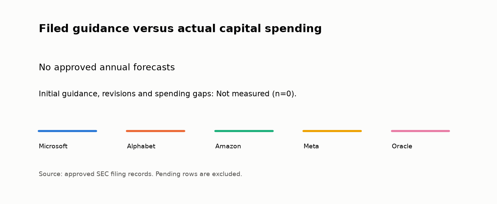
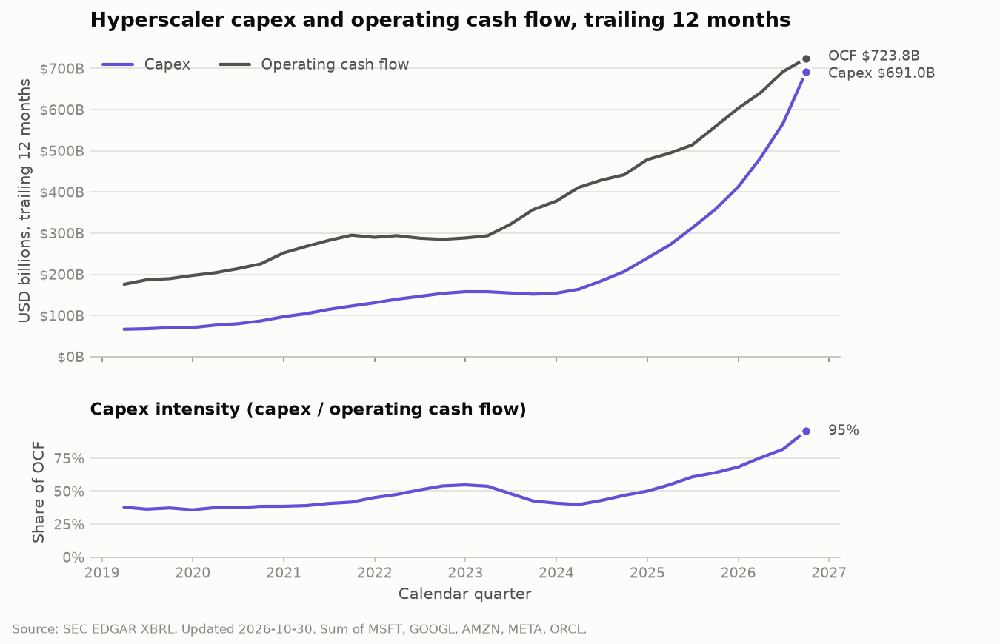
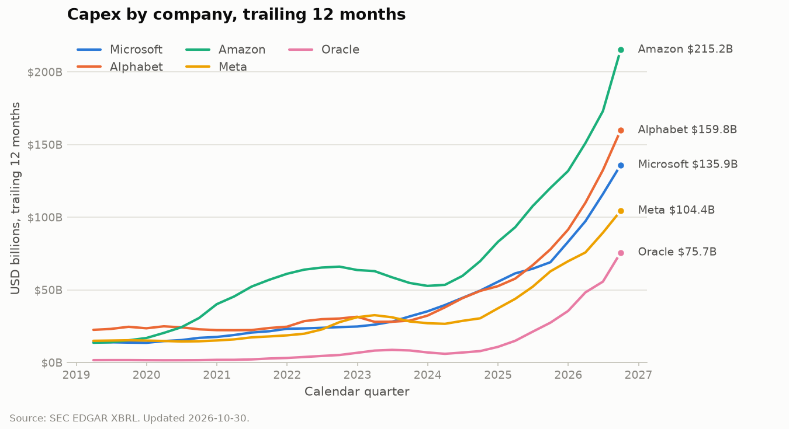
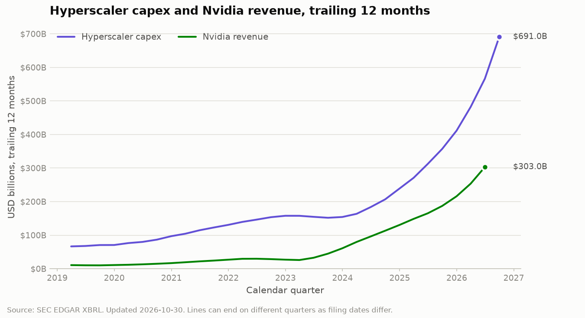

# capex-tracker-ai

Tracks five technology companies' capital spending against operating cash flow and compares filed forecasts with fiscal-year actuals.

> **Start here**
>
> **60 seconds:** Open the [interactive explainer](https://davidgold00.github.io/capex-tracker-ai/) once Pages is enabled, or read the two findings below and the [current status](GUIDANCE_PROGRESS.md).
>
> **10 minutes:** Follow the [interview walkthrough](docs/WALKTHROUGH.md) and replay one claim with `make demo`.
>
> **Deep dive:** Follow the [system and four workflows](docs/WORKFLOWS.md), then inspect the [frozen test](eval/test_results.json), [dev bake-off](eval/MODEL_BAKEOFF.md) and [approval policy](docs/decisions/ADR-005-corroboration-approval.md).

<!-- HEADLINE:START -->
**In the four quarters to Q3 2026, Microsoft, Alphabet, Amazon, Meta and Oracle spent $691.0B on capex, equal to 95% of their operating cash flow, up from 64% a year earlier.**
<!-- HEADLINE:END -->

The default headline covers five issuers over four quarters (n=20 company-quarters per trailing window). Reported capex includes spending outside AI.

## Guidance versus actual spending

<!-- GUIDANCE:START -->
Meta raised the midpoint in 9 of 9 revisions and actual spending was a median +15.5% versus the first approved midpoint (n=3 completed fiscal years), based on 13 auto-corroborated SEC claims (13/13 from Meta, pending human audit).

Human audit pending (n=30 sampled).

| Issuer / FY | First approved range | Last approved range | Actual | Gap vs first midpoint |
|---|---:|---:|---:|---:|
| META FY2023, including lease principal | $27.0B to $30.0B | $27.0B to $30.0B | $28.1B | -1.4% (n=1) |
| META FY2024, including lease principal | $30.0B to $37.0B | $38.0B to $40.0B | $39.2B | +17.1% (n=1) |
| META FY2025, including lease principal | $60.0B to $65.0B | $70.0B to $72.0B | $72.2B | +15.5% (n=1) |
| META FY2026, including lease principal | $115.0B to $135.0B | $135.0B to $145.0B | Not measured | Not measured |

Initial means the earliest approved range in this filing sample. Earlier single-source forecasts can remain pending.

Documents with an identified company-wide spending forecast among SEC filings read: Microsoft 10/32 (0 numeric, 10 direction only), Alphabet 5/33 (4 numeric, 1 direction only), Amazon 11/32 (3 numeric, 8 direction only), Meta 32/32 (32 numeric, 0 direction only), Oracle 2/30 (1 numeric, 1 direction only). One document counts once. Additional guidance given on calls is outside this filing-only search.



[Dated ranges, revisions, definitions and actuals](data/processed/guidance_paths.csv)
<!-- GUIDANCE:END -->

The audit sample contains all 13 auto-corroborated claims and 17 seeded pending items. Open [audit_sample.csv](data/guidance/audit_sample.csv) on GitHub, select the pencil, fill only `david_verdict` and `david_note`, and commit. Mark `correct` if the linked evidence supports the policy decision to approve or withhold, `incorrect` if you disagree, or `unsure`. Agreement is reported separately by decision, excluding blank and unsure verdicts from the denominator. [Audit reporting script](scripts/audit_sample.py).

<!-- UPDATED:START -->
Last updated: 2026-10-30. Latest filing included: Amazon 10-Q, accession 0001018724-26-000040, filed 2026-10-30.
<!-- UPDATED:END -->

<!-- TABLE:START -->
**Latest complete calendar quarter: Q3 2026**

| Company | Capex | OCF | FCF | Capex intensity | YoY capex growth |
|---|---:|---:|---:|---:|---:|
| Microsoft | $39.4B | $58.0B | $18.6B | 68% | +103% |
| Alphabet | $51.4B | $42.3B | -$9.1B | 121% | +114% |
| Amazon | $77.3B | $42.4B | -$34.8B | 182% | +120% |
| Meta | $33.9B | $32.8B | -$1.2B | 104% | +80% |
| Oracle | $28.5B | $23.1B | -$5.4B | 123% | +235% |
| **Total** | **$230.4B** | **$198.6B** | **-$31.8B** | **116%** | **+118%** |
<!-- TABLE:END -->

## Charts

<!-- CHARTS:START -->








<!-- CHARTS:END -->

## What changed

<!-- WHAT_CHANGED:START -->
Aggregate capex rose from $181.5B in Q2 2026 to $230.4B in Q3 2026. Aggregate capex rose from $105.8B in Q3 2025 to $230.4B in Q3 2026. Meta guided to $135.0B to $145.0B for FY2026.

*template-generated, fact-checked*
<!-- WHAT_CHANGED:END -->

## My read this quarter

<!-- NOTES:START -->
Notes coming soon.
<!-- NOTES:END -->

## About me

[DAVID: Add why you built this and what roles you are looking for.]

## Why this matters

Microsoft, Alphabet, Amazon, Meta and Oracle are building data centers for AI workloads, and investors and analysts follow their capital spending closely. Capital expenditure is paid from the cash these companies generate, so its size relative to operating cash flow shows how much of that cash is being committed to infrastructure. Nvidia sells much of the hardware used in these data centers, which makes its revenue a useful view of the other side of the same spending. Companies do not break out AI spending separately, so reported capex is the closest public measure available.

## Methodology

All figures come from the XBRL data companies file with the SEC. No figure is estimated or hand-entered.

**Filed guidance.** A rules baseline and a local Ollama model propose forecasts from earnings exhibits and MD&A. Code checks the quote, dollars, fiscal year and spending definition. Each forecast needs review before comparison with four matched XBRL quarters. The weekly update runs rules on new filings. A verified release and periodic filing can corroborate a claim. Verified dual-extractor agreement and manual review remain separate approval paths. Each approved row names its basis. The quarterly summary uses checked sentences from a fixed plan. [Review evidence and evaluation denominators](GUIDANCE_PROGRESS.md).

**Choosing tags.** Companies label the same line item with different XBRL tags, and change labels over time. `config.yaml` lists candidate tags for each metric. For each company, tags are ranked by the most recent period they cover, then by how many periods they cover. Each period takes its value from the highest-ranked tag that has it, and every data point records its tag. Amazon's capex, for example, moves across three tags between 2017 and 2018. `data/processed/tag_report.csv` shows every choice.

**Turning year-to-date figures into quarters.** Cash flow statements in 10-Qs are cumulative: the Q2 filing reports six months, and Q3 reports nine. Discrete quarters are derived by subtraction (Q2 is six months minus Q1, Q3 is nine months minus six months, Q4 is the full year minus nine months). Periods are classified by their actual start and end dates, within tolerances: 85 to 100 days is a quarter, 175 to 190 is six months, 265 to 280 is nine months, and 355 to 375 is a year. Where a true three-month figure is reported, it is used and compared against the derived one.

Two filing quirks needed handling. Amazon reports trailing-twelve-month figures in its 10-Qs, so a year-long period only counts as a fiscal year if it comes from a 10-K or starts on the same day as a year-to-date period. Oracle's data for fiscal 2018 to 2022 tags the full-year revenue figure as a three-month period, so a three-month value equal to the full-year figure is rejected in favor of the derived one and listed as a warning.

**Duplicates and restatements.** Later filings repeat earlier periods as comparatives. For each tag and period, only the most recently filed value is kept, so restatements win. Accession number breaks ties, and each row keeps its accession number and form type.

**Fiscal calendars.** Microsoft's fiscal year ends in June, Oracle's in May, and Nvidia's in late January. Each quarter is assigned to the calendar quarter containing its midpoint, and both the fiscal label and calendar quarter are stored. A calendar quarter is only aggregated once all five spenders have reported it. A later quarter still in progress is marked partial and excluded from the headline.

**Signs and units.** Capex and lease repayments are stored as positive numbers. Values are stored in US dollars and shown in billions.

**Lease-adjusted capex.** Reported capex excludes assets financed through finance leases. The adjusted version adds principal repayments of finance leases, which follows the free cash flow measure Amazon publishes. The two versions are kept in separate columns, and a quarter without a reported lease figure stays blank rather than being treated as zero.

**Checks on every update.** Results are written to `data/processed/validation_report.md`, and a failure stops the update before anything is published.

- For each fiscal year with a 10-K, the four quarters must sum to the annual figure within 0.5%. When every quarter comes from year-to-date subtraction this holds by construction, so the check mainly catches missing periods and quarters that were reported directly.
- Derived quarterly capex can never be negative.
- Capex moves of more than 60% quarter over quarter are listed for review, but do not stop the update.

## Limitations

- **Optional CoreWeave.** `CRWV` is disabled in `config.yaml`. Enabling it includes CoreWeave in SEC actuals, the aggregate and guidance discovery. Its financial coverage starts in FY2024, the first year with four XBRL quarters for capex, OCF and revenue. FY2023 has annual comparatives and zero derivable quarters. Within coverage the usual annual reconciliation applies.

- **Finance leases.** Coverage varies by company. Alphabet's quarterly lease figures begin in 2024, and Oracle's stop after its February 2026 quarter, so lease-adjusted figures are incomplete for both. The adjustment counts cash repaid on leases, not the value of assets newly acquired under them, so it understates capacity added recently through leasing.
- **Capex is not only AI.** Companies do not report AI capex separately. These totals include warehouses, logistics, offices and other non-AI spending.
- **Tag inconsistency.** Older periods can come from a different tag with a slightly different definition. Amazon's older capex tag, for example, was reported net of incentives. The tag report records where tags disagree.
- **Partial recasts.** When a later filing changes only an annual figure, the difference falls into the derived fourth quarter. Meta's January 2025 10-K restated 2022 and 2023 capex net of proceeds, without recasting the earlier quarters, which shifts about $0.2B into each of those fourth quarters.
- **Calendar mapping.** Midpoint mapping is an approximation. Oracle's quarter ending in August counts as the calendar third quarter, and Nvidia's quarter ending in October does too, though neither lines up exactly with July to September.
- **Freshness.** The data is only as current as the latest 10-Q or 10-K. Companies report on different dates, and a filing can arrive weeks after a quarter ends.

## How to run it locally

```bash
python -m venv .venv && source .venv/bin/activate
pip install -e ".[dev]"
export SEC_USER_AGENT="Your Name <your email address>"

pytest
python -m capex_tracker update
```

SEC requires a User-Agent that identifies you. Other commands:

| Command | What it does |
|---|---|
| `python -m capex_tracker fetch [--refresh]` | Download SEC data into the local cache |
| `python -m capex_tracker build` | Parse, derive, compute and validate |
| `python -m capex_tracker charts` | Render the charts |
| `python -m capex_tracker readme` | Refresh the generated README sections |
| `python -m capex_tracker update [--refresh]` | Run all of the above |
| `python -m capex_tracker inspect --ticker MSFT --metric capex` | Show the chosen tag, every raw fact, and the derived quarters |

## How the automation works

A GitHub Action runs every Monday and on demand. It installs pinned dependencies, runs the tests, refetches SEC data and rebuilds everything. If the processed data, charts or README changed, it commits them. If a validation check fails, the job stops and nothing is committed. Dates in the charts and README come from the newest filing rather than the day of the run, so a week with no new filings produces no commit.

## License

MIT
