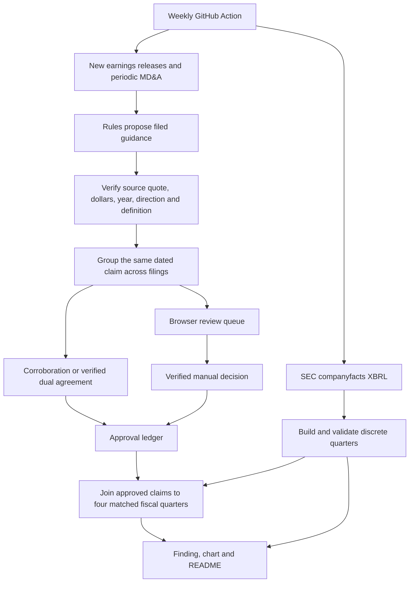
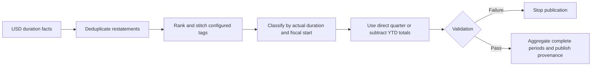
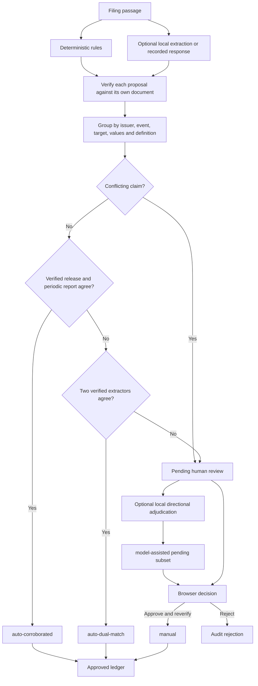
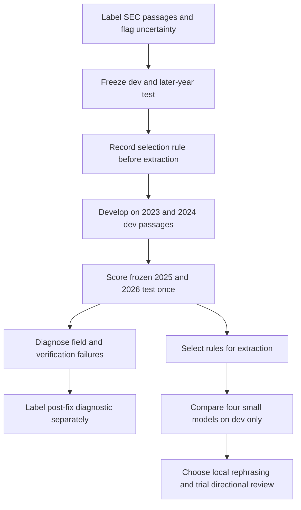
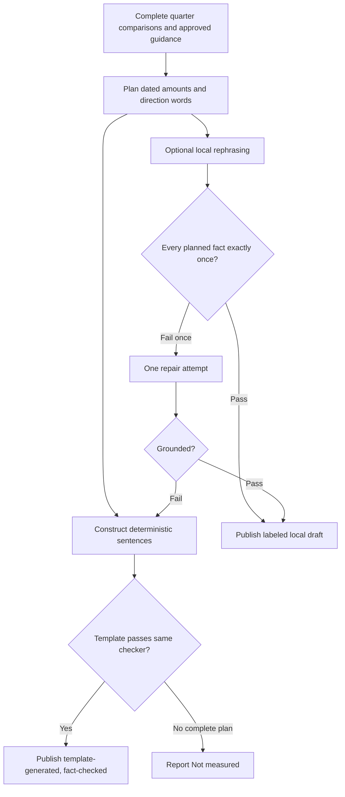

# From filing to finding

## The system

## 1. Financial actuals

Oracle's reported three-month FY2022 Q4 revenue equaled its full-year value. The build derived Q4 from the annual and nine-month totals and recorded the warning. [Validation report](../data/processed/validation_report.md)

## 2. Extraction, review and approval

Meta's FY2024 range of $30B to $37B appears in the February 1 release and February 2 10-K. [Release trace](../data/guidance/traces/META-7dcf3e00303f.json) · [10-K trace](../data/guidance/traces/META-6e73e0ba7afe.json)

## 3. Evaluate the extractor and local model jobs

The frozen test selected rules with 13/13 detected positives. Four later dev comparisons supplied a different measurement for each model job. [Frozen scores](../eval/test_results.json) · [Bake-off](../eval/MODEL_BAKEOFF.md)

## 4. Publish the quarterly paragraph

For Q3 2026 the planner compares $230.4B with $181.5B a quarter earlier and $105.8B a year earlier. The current plan also includes Meta's approved range. [Planner and checker](../src/capex_tracker/guidance/ground.py)
